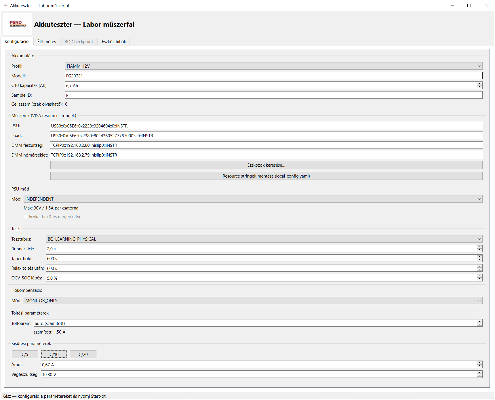
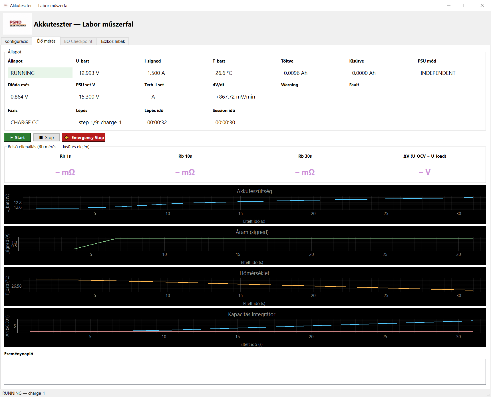
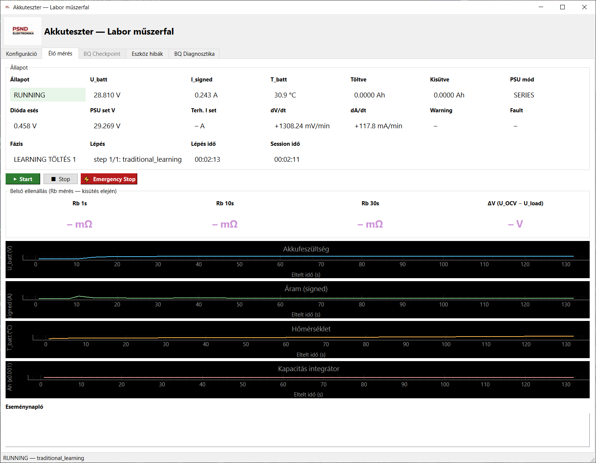
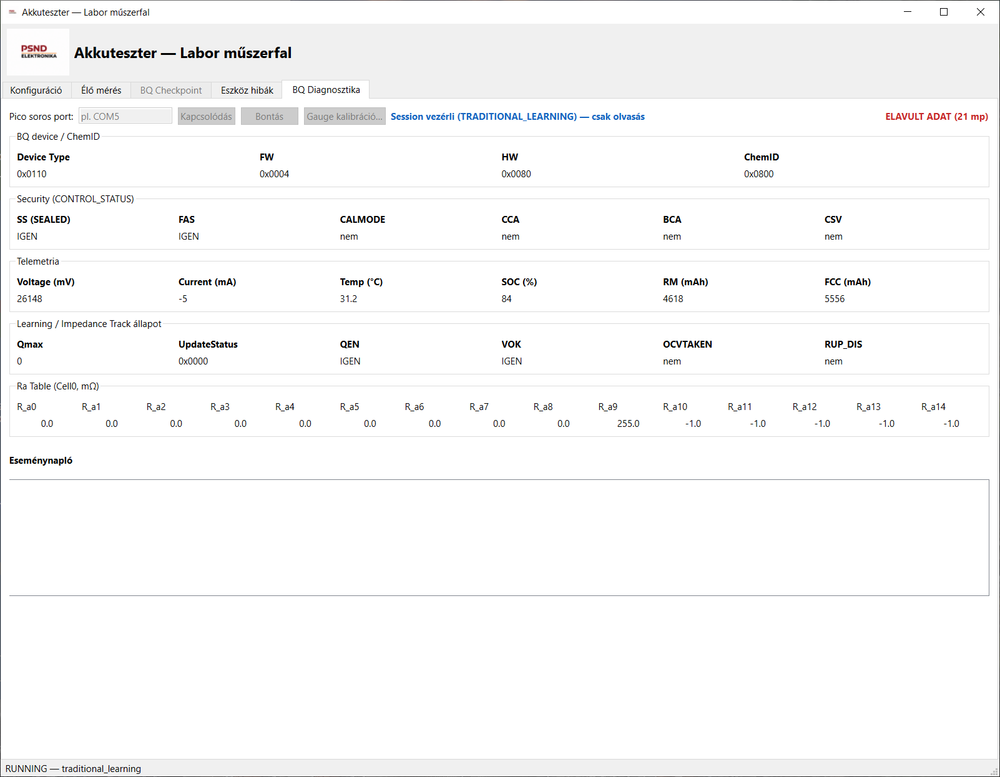
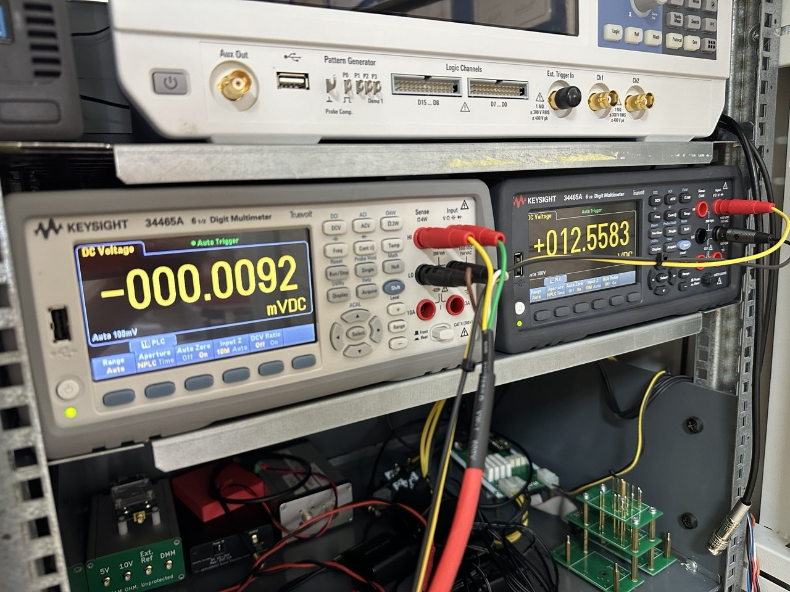
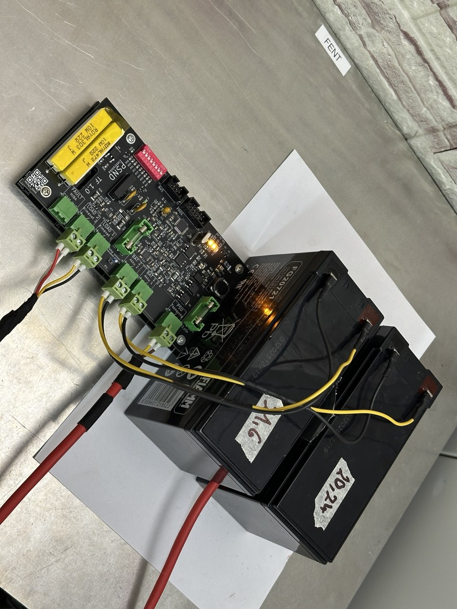
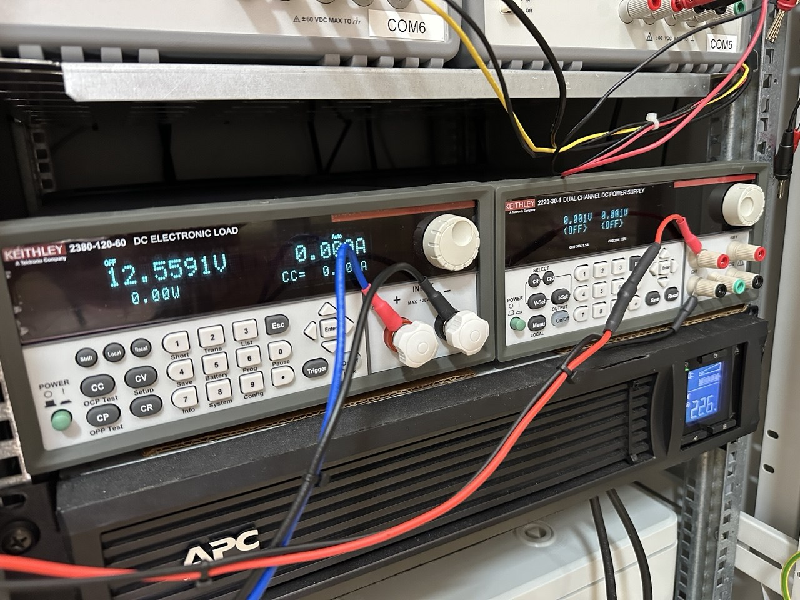
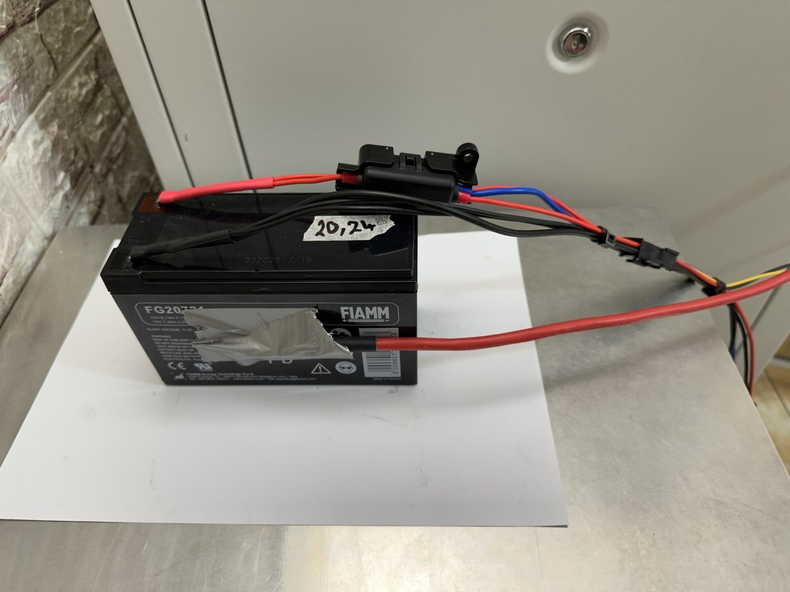

# Akkuteszter

> **Fejlesztés alatt; unit/mock tesztelt; a fizikai validálás részleges; energizált mérés és BQ-írás csak felügyelt, jóváhagyott mérésnél engedélyezett.**

Windows-os Python/PySide6 laborprogram FIAMM AGM/VRLA akkumulátorok méréséhez. Töltést, kisütést, kapacitásmérést, OCV–SOC- és ellenállásmérést, valamint a TI BQ34Z110 golden image előkészítését automatizálja.

## Képernyőképek

| | |
|---|---|
| <br>*Konfiguráció — akkumulátorprofil, műszerek, PSU-mód, teszttípus* | <br>*Élő mérés, töltési fázis* |
| <br>*Élő mérés, Traditional Learning munkamenet* | <br>*BQ Diagnosztika munkamenet alatt, csak olvasással és elavultságjelzéssel* |

## Laborfotók

| | | | |
|---|---|---|---|
|  |  |  |  |

## Hardver

| Eszköz | Feladat | Kapcsolat |
|---|---|---|
| Keithley 2220-30-1 | Töltő tápegység, INDEPENDENT/PARALLEL/SERIES mód; 24 V-os pakkhoz SERIES kötelező | USB/VISA |
| Keithley 2380-120-60 | Elektronikus terhelés kisütéshez és ellenállásméréshez, legfeljebb 250 W | USB/VISA |
| Keysight 34465A ×2 | Akkukapocs-feszültség és hőmérséklet; 4-eres PT100 vagy 2-eres 10 kΩ-os NTC | LAN, SCPI/HiSLIP |
| Raspberry Pi Pico + BQ34Z110 | Gauge-kommunikáció a tanításhoz, Golden GG-hez, diagnosztikához és kalibrációhoz | USB, soros port |

A teszttípusokhoz mind a négy VISA-műszer szükséges; a program `*IDN?` alapján ellenőrzi a típust. USB- és LAN-kapcsolathoz is PyVISA és NI-VISA szükséges.

Beépített profilok: `FIAMM_12V` — 6 cella; `FIAMM_24V` — 12 cella, két 12 V-os akkumulátor sorba kötve.

## Üzemmódok

| GUI-teszttípus | Feladat |
|---|---|
| `CHARACTERIZATION` | Töltés → relaxáció → kapacitásmérő kisütés → 5 h relaxáció. |
| `BQ_LEARNING_PHYSICAL` | Két fizikai töltés–kisütés ciklus relaxációkkal, végül kézi BQ-ellenőrzési pont; Pico nélkül. |
| `OCV_SOC_CHARACTERIZATION` | Labor-OCV–SOC görbe és `R_pulse` impulzus-ellenállás; alapból 5%-os C/10 lépések a profil végfeszültségéig. |
| `CHEMID_CHARACTERIZATION_PBA` | Kondicionálás → töltés → 5 h relax → C/20 kisütés → 5 h relax → GPCCHEM-export. |
| `CHARGE_ONLY` | DMM-visszacsatolt, diódaesés-kompenzált CC/CV töltés, majd állítható relaxáció. |
| `DISCHARGE_ONLY` | CC kapacitásmérés és névleges 1/10/30 s-os feszültségeséses ellenállásbecslés, mentett tényleges időponttal és minőségjelzéssel. |
| `TRADITIONAL_LEARNING` | BQ-tanítás, BQ-adatok alapján minősített eredmény, majd automatikus 0,67 A-es záró újratöltés. |
| `GOLDEN_GG` | Kísérleti mérési csomag megadott rendszerárammal; a `lowtemp.csv` és a natív TI `gg.csv` export hiányzik. |
| `IEC_DC_INTERNAL_RESISTANCE` | Kétpontos DC Ri-mérés, Ia = 4·I10 és Ib = 20·I10; a szabványeljárás forrása nem ellenőrzött, 24 V-os FG20721-pakkon a 250 W-os korlát miatt nem használható. |

A töltés utáni relaxáció `CHARGE_ONLY` és `CHARACTERIZATION` módban alapból 600 s, állítható; `BQ_LEARNING_PHYSICAL` módban 2 h. A külön kisütés utáni relaxlépések 5 órásak. Az önálló relaxáció dV/dt-értéke diagnosztikai adat, nem rövidíti le a várakozást.

A kisütési ellenállásbecslés, az OCV–SOC műszer-időzített `R_pulse` mérése és az IEC DC Ri külön mérési módszer.

A Traditional Learning a BQ-eredményt a záró töltés előtt rögzíti; a következő kampány legkorábbi időpontját a sikeres záró töltés befejezése után 48 órára menti.

- **BQ Diagnosztika fül:** gauge-adatok megtekintése, futó BQ-munkamenet alatt csak olvasással.
- **„Gauge kalibráció…” ablak:** a BQ Diagnosztika fülről nyílik; előtte állítsd le a mérést és bontsd a diagnosztikai kapcsolatot.
- **Eszközök → Pico előkészítése BQ34Z110-hez…:** a mellékelt firmware feltöltése friss MicroPython-os Picóra, bekötési útmutatóval.

Csak Python-modulként érhető el a validation matrix, a golden image manifest, a gyártási programozás és a TI Golden GG eredményimport; kezelői belépési pontjuk nincs.

## Biztonság

- Kapcsolódáskor a PSU minden kimenete és a Load bemenete kikapcsol; Stopnál, hibánál, befejezéskor és vészleállításkor a sorrend: **Load OFF → PSU ALL OFF**. Az egyik kikapcsolási hibája nem akadályozhatja a másik megkísérlését.
- A PSU és a terhelés nem lehet egyszerre aktív.
- FG20721 normál kisütésénél C10, más vagy bizonytalan ráta esetén legalább **1,80 V/cella** a megengedett végfeszültség. A kód csak igazolt adatlapi C20-bázissal — 7,2 Ah, 0,36 A — enged **1,75 V/cellát**; a C/20 beállítás önmagában nem elegendő. A ChemID jelenlegi végfeszültsége **1,80 V/cella**.
- Az adatlapi végfeszültség alá kizárólag **Traditional Learning** módban szabad kisütni, az Update Status 06 / golden image céljára, az akkumulátor elhasználásának tudatos vállalásával. A tanítás legkisebb névleges szoftveres lekapcsolási küszöbe **1,70 V/cella**, pakkszintű felügyelettel; a lezáró minta ez alá is eshet.
- Valós kimenetbekapcsolás, BQ Data Flash-írás, seal/unseal és tanítás csak explicit jóváhagyott, felügyelt mérésnél végezhető.
- A Keithley 2220 előlapján az Output Recall legyen Off (Menu → User Settings); a program ezt nem ellenőrzi.
- A `Prog/tools/` szkriptjei valós műszerkimenetet kapcsolhatnak; futtatásukra ugyanez a jóváhagyási és felügyeleti feltétel érvényes.

## Telepítés és indítás

Telepítsd az NI-VISA-t. Forrásból, a repó gyökerében:

```bash
python -m pip install -r requirements.txt
python -m Prog.main
```

A GUI valós műszerekkel dolgozik. A helyi konfiguráció forrásindításnál `Prog/config/local_config.yaml`, EXE-nél az exe melletti `local_config.yaml`. Hiányzáskor a program a sablonból automatikusan létrehozza, placeholder-címekkel.

Állítsd be a négy VISA-resource-ot és a tényleges szondához tartozó `temperature_sensor_mode` értéket: `RTD_4W_PT100` vagy `THERMISTOR_2W_NTC_10K_B3950`. A **Resource stringek mentése** gomb csak a négy műszercímet menti.

Telepítési útmutató: [INSTALL.md](INSTALL.md); az EXE-csomagban `_internal/INSTALL.md`.

## Kezelés

1. A **Konfiguráció** fülön válassz profilt, modellt, teszttípust és PSU-módot; add meg a C10-kapacitást, a Sample ID-t, a műszercímeket és a módfüggő paramétereket. A **C10 kapacitás (Ah)** az adatlapi 10 órás kapacitás, a C/x áramok és az alapértelmezett 0,25·C10 töltőáram alapja. FG20721 esetén 6,7 Ah; két soros akkumulátornál is 6,7 Ah. PARALLEL/SERIES módban ellenőrizd a bekötést, majd jelöld be a **Fizikai bekötés megerősítve** mezőt.
2. Az **Élő mérés** fülön válaszd a **Start** gombot, ellenőrizd és erősítsd meg az összefoglalót. Futás alatt a Konfiguráció zárolt. A kézi ellenőrzési pont a **BQ Checkpoint**, a műszerhibák az **Eszköz hibák** fülön láthatók.
3. A **Stop** kikapcsolást kezdeményez és lezárja a munkamenetet. Az **Emergency Stop** vészleállítást kér, és FAULT állapottal zár. Az így lezárt munkamenet nem folytatható.
4. Összeomlás vagy áramkimaradás után a Start felajánlhatja a folytatást, ha a konfiguráció, profil, műszerek és Sample ID egyezik, és van mentett biztonságos lépéshatár. Folytatáshoz ugyanaz az akkumulátor és fizikai felállás szükséges.

A `TRADITIONAL_LEARNING` és `GOLDEN_GG` FG20721-modellt és egész számú 6,7 Ah-s C10-többszöröst igényel; add meg a Pico portját is. Golden GG-hez a rendszerre jellemző kisütőáramot külön kell megadni.

A kisütött akkumulátorral záruló módok után töltsd újra az akkut; a GUI figyelmeztet.

Az eredmények az exe mappájában, forrásindításnál a repó gyökerében találhatók: `Mérések/Sessions/session_<modell>_<UTC-idő>/`. Fő fájlok: `samples.csv`, `events.csv`, `device_errors.csv`, `session.db`, `checkpoint.json`, `report.json` és a módfüggő exportok. A diagnosztikai napló `logs/akkuteszter.log` alatt gyűlik, WARNING szinttől, UTF-8 formátumban, hozzáfűzéssel és automatikus rotáció nélkül.

### EXE build (PyInstaller)

**A használt `dist\akkuteszter\` mappába közvetlenül buildelni tilos: a COLLECT törli a helyi konfigurációt és a mérési adatokat.**

1. Zárd be az alkalmazást. Mentsd a teljes telepítési mappát a repón és a telepítésen kívülre, a `local_config.yaml`, `Mérések\` és `logs\` tartalmával együtt. A telepítési mappa az `akkuteszter.exe`-t tartalmazó könyvtár, például `dist\akkuteszter\`.
2. A futtatási függőségek mellé telepítsd a PyInstallert ugyanahhoz a Pythonhoz:

   ```bash
   python -m pip install pyinstaller
   ```

   Csak tiszta követett munkafából buildelj, staged és nem staged követett módosítás nélkül. A repó gyökeréből rögzítsd a build eredetét; a kimeneteket külső mentési helyre tedd:

   ```bash
   git rev-parse HEAD
   git status --short
   python -m pip freeze
   ```

3. Minden buildhez használj új, a teljes repón és a telepítésen kívüli stagingkönyvtárat: `<build-gyökér>\<dátum>_<commit>\dist|work`. A helyőrzőket cseréld tényleges útvonalra; a stagingbe ne tegyél helyi konfigurációt vagy mérési adatot. A repó gyökeréből:

   ```powershell
   python -m PyInstaller --noconfirm --clean --distpath "<build-gyökér>\<dátum>_<commit>\dist" --workpath "<build-gyökér>\<dátum>_<commit>\work" akkuteszter.spec
   ```

   A `--noconfirm` kérdés nélkül engedélyezi a COLLECT kimeneti mappájának teljes törlését; a `--clean` nem védi a felhasználói adatokat. A korábbi stagingbuildeket őrizd meg.

4. Ellenőrizd a staging `dist\akkuteszter\` csomagját:
   - `_internal/Prog/config/`: `default_config.yaml`, `local_config.template.yaml`, valamint `battery_profiles/FIAMM_12V.yaml` és `FIAMM_24V.yaml`;
   - `_internal/Prog/resources/psnd.png`;
   - `_internal/Prog/pico_firmware/`: `main.py`, `pico_bq_rpc.py`, `pico_bq_service.py`;
   - `_internal/INSTALL.md`.

   Vizsgáld meg az importhiányokat a `<build-gyökér>\<dátum>_<commit>\work\akkuteszter\warn-akkuteszter.txt` fájlban.

5. A bezárt telepítésben **csak az `akkuteszter.exe`-t és a teljes `_internal\` mappát cseréld** a staging megfelelő elemeire. A `local_config.yaml`, `Mérések\` és `logs\` maradjon meg. Új telepítésnél a teljes staging `dist\akkuteszter\` mappát másold a célhelyre.
6. Első indítás előtt ellenőrizd az exe melletti `local_config.yaml` műszercímeit és szenzormódját. Hiányzó fájl az `_internal/Prog/config/local_config.template.yaml` sablonból előre elkészíthető; az alkalmazás hiányzáskor maga is létrehozza. Ezután a telepítési mappa új exe-jét indítsd.

## Tesztek futtatása

A projektgyökérből, Git Bash alatt, **négy külön invokációban**, ebben a sorrendben:

```bash
export PYTHONDONTWRITEBYTECODE=1 QT_QPA_PLATFORM=offscreen
timeout 900 python -m pytest Prog/tests --ignore=Prog/tests/gui -q -p no:cacheprovider
timeout 900 python -m pytest Prog/tests/gui/test_build_runner.py -q -p no:cacheprovider
timeout 900 python -m pytest Prog/tests/gui --ignore=Prog/tests/gui/test_build_runner.py --ignore=Prog/tests/gui/test_main_emergency_excepthook.py -q -p no:cacheprovider
timeout 900 python -m pytest Prog/tests/gui/test_main_emergency_excepthook.py -q -p no:cacheprovider
```

A példák mock/fake környezetre szólnak; teszt/próba valós soros portot vagy VISA-erőforrást nem nyithat. Csonkult/kimaradt futás nem teljes PASS.

Statikus ellenőrzések — ismert, nem nulla alapállapot; új diagnosztika ne kerüljön be:

```bash
python -m ruff check Prog
python -m mypy Prog
```

## Projektszerkezet

```text
Prog/
├── gui/             # Kezelőfelület
├── src/             # Mérési folyamatok, biztonság, naplózás és export
├── drivers/         # Műszer- és Pico-driverek
├── config/          # Konfigurációk és akkumulátorprofilok
├── resources/       # Logó
├── pico_firmware/   # Picóra feltölthető MicroPython-fájlok
├── tests/           # Mock/fake és GUI-tesztek
└── tools/           # Segédszkriptek, valós műszervezérléssel is
Mérések/Sessions/    # Futás közben létrejövő mérési adatok
logs/                # Diagnosztikai napló
```

## Licenc

[MIT](LICENSE) — Copyright (c) 2026 kvez
